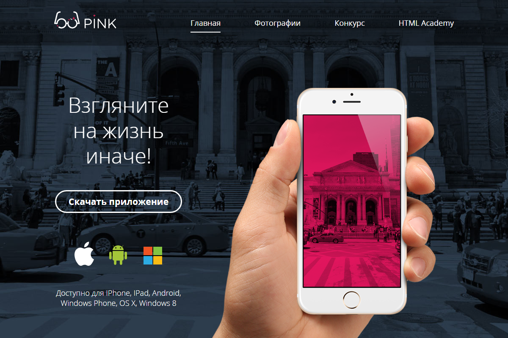
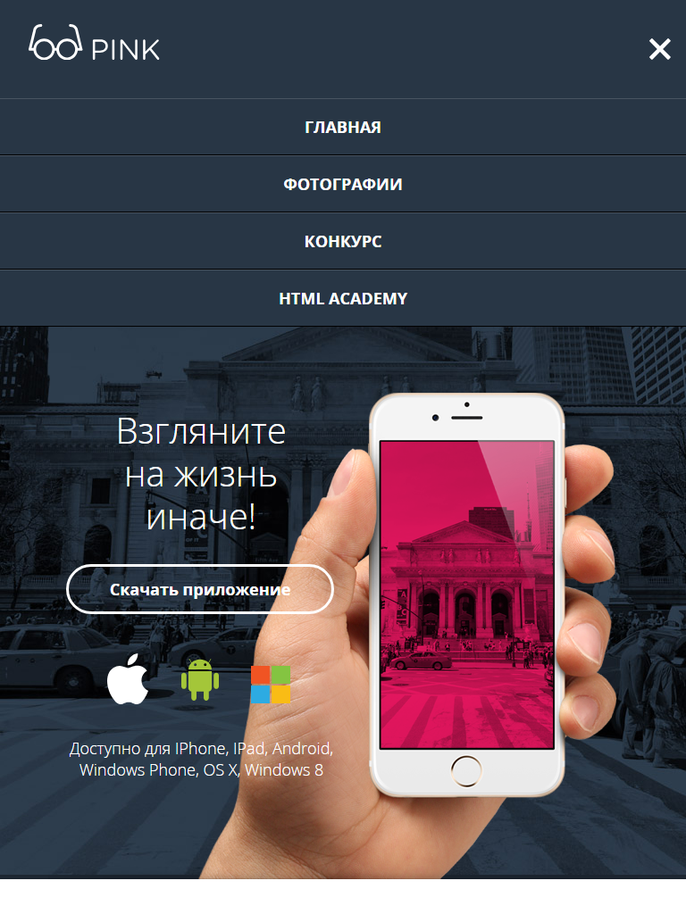
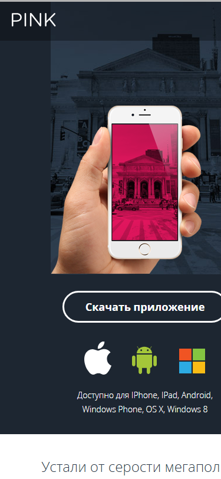
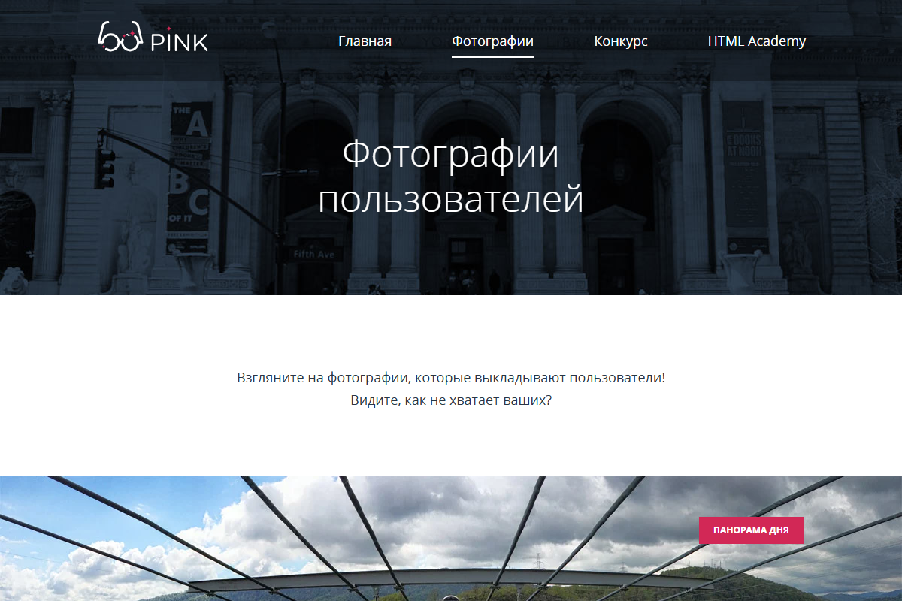

# Pink — адаптивный лендинг

Промо-сайт приложения для обработки фотографий «Pink»: три страницы — главная, лента фотографий пользователей с редактором и форма конкурса.

**Демо:** <https://nothingvrs.github.io/Pink/>

| Десктоп | Планшет | Мобайл |
| --- | --- | --- |
|  |  |  |



## Стек

- HTML5, LESS (БЭМ)
- Gulp 4: LESS → PostCSS/autoprefixer, локальный сервер (browser-sync)
- Ванильный JS (ES5): мобильное меню-бургер, picturefill, SVG-спрайт (svgxuse)

## Что реализовано

- Адаптивная вёрстка под три брейкпоинта: мобайл / планшет / десктоп
- БЭМ-методология и блочная структура LESS (`docs/less/blocks/`)
- Картинки @1x/@2x и webp через `<picture>`, SVG-спрайт иконок
- Мобильное меню-бургер (работает и без JS — меню раскрыто)
- Страница «Фотографии»: лента постов, панорама дня, фоторедактор
- Страница «Конкурс»: форма с ползунками редактора

## Структура

```
docs/          исходники и готовый сайт (из этой папки отдаётся GitHub Pages)
  less/        LESS-блоки
  css/         собранные стили
  js/          menu.js, picturefill.js, svgxuse.js
  img/         изображения, спрайты
screenshots/   скриншоты для README
```

## Запуск

Сайт статический — достаточно открыть `docs/index.html`.

Для разработки со сборкой стилей и livereload:

```bash
npm install
npm start
```

> Сборка на Gulp 4 (инструменты 2019 года, `engines: node 8.12`). Для просмотра сайта сборка не нужна — `docs/css/style.css` уже собран и закоммичен.

## Учебный проект

Курс «[Профессиональный HTML и CSS, уровень 2 (адаптив)](https://htmlacademy.ru/intensive/adaptive)», HTML Academy.
Автор: [Роман Верещагин](https://github.com/Nothingvrs).
